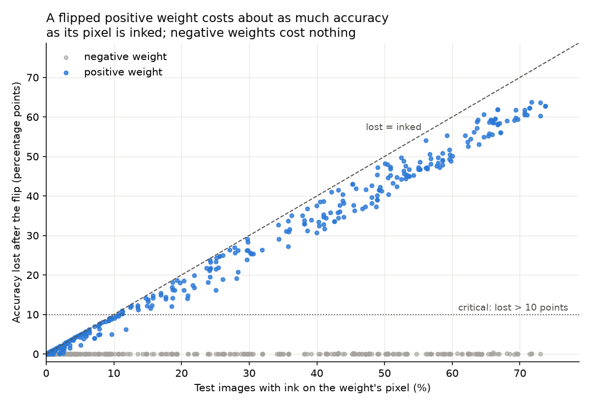

# bitflip-ml

**How much damage does one flipped bit do to a neural network, which bits cause it, and can cheap defenses stop it?**

[GPUHammer](https://arxiv.org/pdf/2507.08166) (USENIX Security 2025) showed that Rowhammer can flip bits in GPU memory, and that a single flip in a model weight can drop ImageNet accuracy from 80% to under 0.1%. This project simulates that attack in software to explain *which* flips break a model and *why*, compares weight formats (FP32, FP16, BF16), and tests four defenses.

All bit flips here are simulated by editing weights in memory. No hardware is attacked.



## Key findings

1. **One bit is enough, but only the right one.** Flipping the exponent's most significant bit (0 → 1) turns a small weight like 0.05 into about 10^37. Flips in the 23 mantissa bits change accuracy by at most 0.05 points.
2. **Where the weight sits decides the damage.** On an MNIST classifier (97.23%), a flip in a hidden-layer bias dropped accuracy to 8.92% (the model answered "5" for every image), while flips in two first-layer weights barely mattered.
3. **About 1 in 4 random flips is critical.** Of 1,000 random flips, 22.6% cut accuracy by more than 10 points, so a blind attacker needs about 4 attempts.
4. **Damage is predictable from two facts.** A first-layer flip is critical only if the weight is positive (ReLU silences negative ones: 0 of 471 critical) and its pixel is inked in more than about 10% of images. The accuracy lost is about 0.9 × the share of images inked at that pixel (figure above).
5. **16-bit formats are about 2× more exposed.** FP16's worst flip is "only" 65,000× instead of 10^37×, yet it breaks the model almost as often (21.5% vs 22.6%). Because the dangerous bit is 1 in 16 bits instead of 1 in 32, a random flipped memory bit is about twice as likely to break an FP16 or BF16 model.
6. **Cheap defenses stop the obvious attack.** A per-layer range clamp (with a NaN check) stopped all 226 critical flips for 0.45 ms per use. A checksum with a clean backup repaired every flip exactly, at 3× the cost and double the memory.

## Results

### Single flips (MNIST, FP32)

| Target | Before | After bit-30 flip | Accuracy |
| --- | --- | --- | --- |
| None (baseline) | | | 97.23% |
| `hidden.weight[0, 300]`, negative | −0.019 | −6.5 × 10^36 | 97.17% |
| `hidden.weight[0, 249]`, positive | 0.164 | 5.6 × 10^37 | 95.72% |
| `hidden.bias[120]`, positive | 0.215 | 7.3 × 10^37 | **8.92%** |

### 1,000 random flips (MNIST, FP32)

| First-layer weights hit | Critical (> 10 points lost) |
| --- | --- |
| Negative | 0 of 471 (0%) |
| Positive, pixel inked in under 10% of images | 0 of 295 (0%) |
| Positive, pixel inked in 10–30% of images | 65 of 69 (94%) |
| Positive, pixel inked in over 30% of images | 157 of 157 (100%) |

Overall: 226 of 1,000 critical (22.6%), including 4 of 7 output-layer weights. Worst single flip: 19.21%.

### Weight formats (MNIST, same 1,000 weights)

| Format | Baseline | Critical per random weight | Critical per 1,000 random memory bits |
| --- | --- | --- | --- |
| FP32 | 97.23% | 22.6% | 7.1 |
| FP16 | 97.23% | 21.5% | 13.4 |
| BF16 | 97.23% | 22.6% | 14.1 |

### Defenses (MNIST, same 1,000 flips replayed)

| Defense | Still critical | Worst accuracy | Overhead per use |
| --- | --- | --- | --- |
| None | 226 / 1000 | 19.21% | 0 ms |
| Range clamp + NaN check | 0 / 1000 | 97.13% | 0.45 ms |
| Activation clip (hidden layer) | 6 / 1000 | 19.21% | 0.01 ms |
| Checksum + restore | 0 / 1000 | 97.23% | 1.44 ms |

No defense changed clean accuracy. The activation clip cannot protect the output layer, which feeds the scores directly.

### ResNet50 (ImageNet model, in progress)

Pretrained ResNet50 (`IMAGENET1K_V2`) on 1,000 [Imagenette](https://github.com/fastai/imagenette) validation photos: **89.10%** baseline. Random-flip sweep in FP32 and FP16 (300 attempts each) on a Colab T4 GPU. *Results to be added.*

## Limitations

- **Simulation, not a hardware attack.** Flips are written directly into memory; which bits real hardware can flip, and in which direction, is not modelled. Real Rowhammer flips are usually one-directional, while this project flips regardless of direction (the original bit is recorded in the CSVs).
- **Small model, one seed.** Most results are from a two-layer fully connected network on MNIST with seed 0. Convolutional networks reuse each weight across the whole image, so their behaviour may differ (the ResNet50 run tests this).
- **Exposure per memory bit** assumes only the exponent's most significant bit is dangerous. Step 1 supports this for small weights, but every bit position was not swept in every format.
- **Defenses were tested against bit-30 flips only.** An attacker who keeps the damage inside the normal range (a sign flip, a lower exponent bit) would pass the range clamp and the activation clip. The checksum's backup lives in the same memory and could in principle be attacked too.

## Reproduce

Python 3.10+.

```bash
python -m venv .venv
# Windows: .venv\Scripts\activate    macOS/Linux: source .venv/bin/activate
pip install -r requirements.txt

python src/bits.py            # Step 1: flip each bit of sample FP32 values
python src/models.py          # Step 2: train the MNIST model (about 1-2 min), saves results/mnist_fp32.pt
python src/flip_one.py        # Step 3: single flips on chosen weights and a bias
python src/sweep.py           # Step 4: 1,000 random flips, saves results/sweep_mnist_fp32.csv
python src/analyze.py         #         split results by weight sign and pixel ink
python src/plot.py            #         figure: results/ink_vs_damage.png
python src/sweep_formats.py   # Step 4c: FP32 vs FP16 vs BF16
python src/defenses.py        # Step 5: replay the 1,000 flips against four defenses
```

Every script uses a fixed seed, so results match the tables above. MNIST downloads automatically to `data/`.

## Repository layout

```
src/
  bits.py            flip a bit in an FP32 value; field names
  models.py          MNIST data, the network, training and evaluation
  flip_one.py        flip every tested bit of one chosen number
  sweep.py           random-flip sweep and fast evaluation
  analyze.py         critical rate by weight sign and pixel ink
  plot.py            ink-vs-damage figure
  sweep_formats.py   the sweep in FP32, FP16 and BF16
  defenses.py        four defenses, replayed against the same flips
results/             trained model, CSVs of every attempt, figures
```

## References

- S. Lin et al., [GPUHammer: Rowhammer Attacks on GPU Memories are Practical](https://arxiv.org/pdf/2507.08166), USENIX Security 2025.
- S. Hong et al., [Terminal Brain Damage: Exposing the Graceless Degradation in Deep Neural Networks Under Hardware Fault Attacks](https://www.usenix.org/conference/usenixsecurity19/presentation/hong), USENIX Security 2019. This project uses their simulation method.
- Y. Kim et al., [Flipping Bits in Memory Without Accessing Them](https://users.ece.cmu.edu/~yoonguk/papers/kim-isca14.pdf), ISCA 2014.
